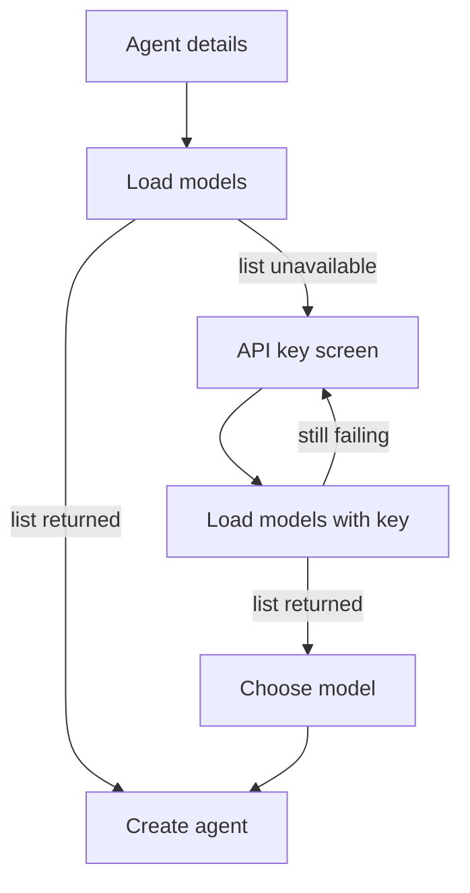

# Model key wizard

When the New agent form cannot load a provider’s models, it no longer asks the user to type a model id. The next screen asks for that provider’s API key and shows the steps to create or retrieve it. After the key loads the list, the following screen asks which model to use.

OpenRouter still lists models on the first screen with no key (about 470 models today). `(Hermes default)` and `Other…` stay as they are: no key screen, model stays optional free text.

## Flow

The existing dialog in [hermes-operator/internal/server/ui.html](hermes-operator/internal/server/ui.html) becomes three steps. The primary button is **Create** when a model list is already loaded, the provider is empty, or the provider is `Other…`. It is **Next** when a known provider was chosen and `POST /api/models` failed.

- **API key screen.** Title is the provider label. A numbered list and a link come from that provider’s `keySteps` and `keyURL`. The input is `type="password"`. **Next** posts `{provider, apiKey}` to the existing `POST /api/models`. A failure stays on this screen and shows the error. **Back** returns to the agent form. A secondary **Type a model id instead** opens the model screen as a text field so an outage still does not block creating an agent.
- **Model screen.** A `<select>` of `(Hermes default)`, every returned model, and `Other…` (text box). **Back** returns to the key screen with the key kept. **Create** submits.
- The key is sent on create as `env[keyEnv]` (for example `ANTHROPIC_API_KEY`), merged with the advanced `KEY=value` lines. The key from this screen wins if both set one. Storage is unchanged: [hermes-operator/internal/agent/service.go](hermes-operator/internal/agent/service.go) already puts `env` in the agent Secret. The lookup itself still does not store the key.

## Key instructions

Add `keyURL` and `keySteps` to each built-in entry in [hermes-operator/internal/models/providers.yaml](hermes-operator/internal/models/providers.yaml). [PublicProvider](hermes-operator/internal/models/models.go) returns them from `GET /api/providers`. `modelsURL` stays server-side. Chart `providers:` entries can set the same fields; `toYaml` already passes them through. A provider with no steps shows only “Paste a `KEYENV` key” plus `keyURL` when set.

- **Anthropic** — [platform.claude.com/settings/keys](https://platform.claude.com/settings/keys). Sign in, click **Create key**, name it, set Linked account to yourself, copy the `sk-ant-` key (shown once).
- **OpenAI** — [platform.openai.com/api-keys](https://platform.openai.com/api-keys). Click **Create new secret key** and copy it (shown once).
- **DeepSeek** — [platform.deepseek.com/api_keys](https://platform.deepseek.com/api_keys). Click **Create new API key**, copy the `sk-` key (shown once). Mention topping up if the balance is empty.
- **xAI** — [console.x.ai](https://console.x.ai/). Open **API Keys** in the sidebar, click **Create API key**, copy it (shown once). Mention adding credits if the account is empty.
- **Fireworks** — [app.fireworks.ai/settings/users/api-keys](https://app.fireworks.ai/settings/users/api-keys). Click **Create API Key** and copy it.
- **OpenRouter** — only if its public list fails. [openrouter.ai/keys](https://openrouter.ai/keys). Click **Create Key**, copy the `sk-or-` key (shown once). The steps say this key is stored on the agent and is not required to list models.

## Tests and docs

- UI cases in [hermes-operator/test/ui/ui.test.js](hermes-operator/test/ui/ui.test.js): OpenRouter stays a model dropdown with no key screen; a keyed provider’s **Next** shows the returned steps and link; a valid key advances to the model select and create sends `model.name` plus `env.ANTHROPIC_API_KEY`; a rejected key stays on the key screen; **Type a model id instead** submits the typed id; `Other…` never opens the key screen.
- Go: built-in providers have a `keyURL` and at least three steps; `GET /api/providers` includes `keySteps` and `keyURL` and still omits `modelsURL` ([hermes-operator/internal/server/coverage_test.go](hermes-operator/internal/server/coverage_test.go)).
- Bump Chart, MCP `serverInfo`, and README pins from 0.0.4 to 0.0.5. Update the Creating agents paragraph. Add [hermes-operator/plans/0011-model-key-wizard.md](hermes-operator/plans/0011-model-key-wizard.md) and link it from the Plans table.
- Do not publish the chart or change the live gateway. The cluster keeps `ghcr.io/dbslone/hermes-operator:0.0.4` until a release is cut and `gateway-helm` is bumped.
