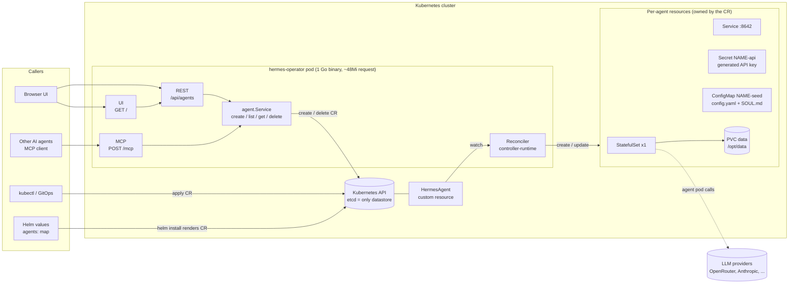
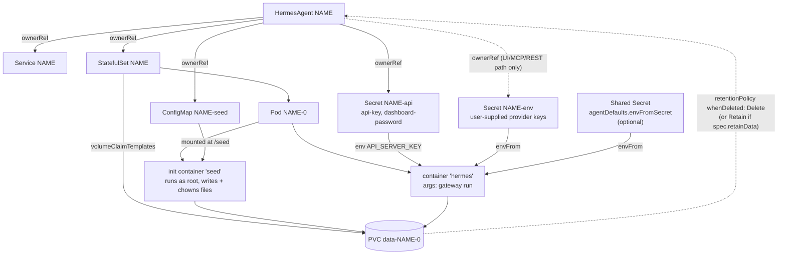
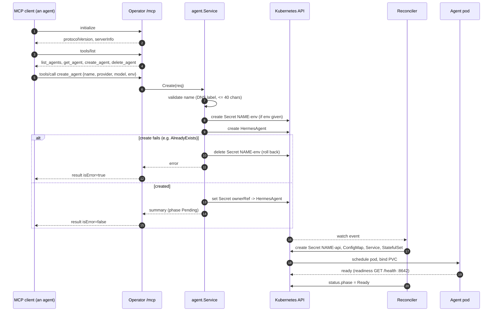
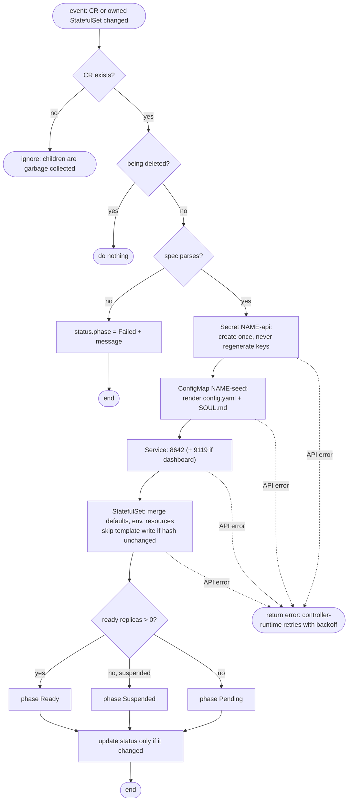
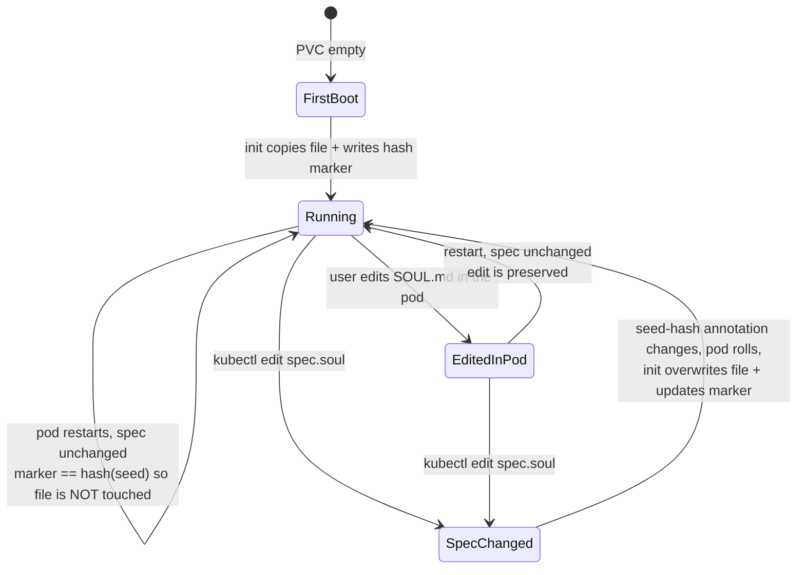
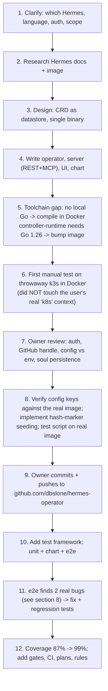
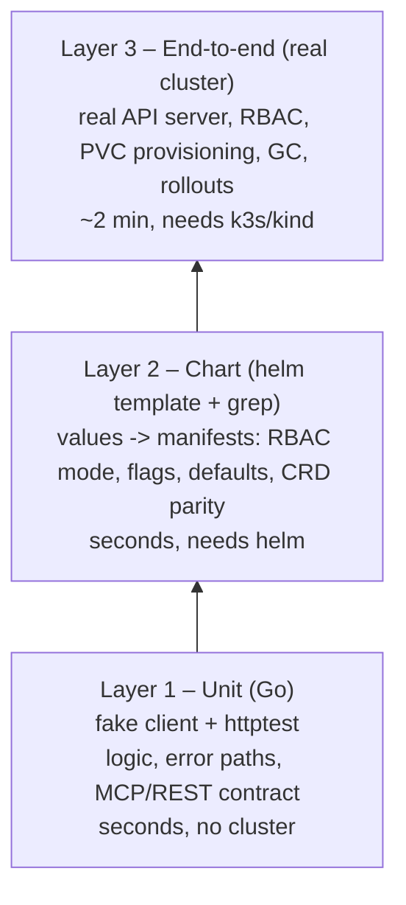

# 0001 – How we got here: design, tech choices and testing

- **Status:** done (baseline for everything after it)
- **Date:** 2026-10-16
- **PR:** initial implementation + test suite
- **Related plans:** [0002 PR review and test gates](0002-pr-review-and-test-gates.md) · [0003 Test coverage map](0003-test-coverage-map.md)

This is the record of how `hermes-operator` went from a one-paragraph request to its current state: what was asked, what was decided and *why*, what was built, how it was verified, and which bugs the tests caught along the way. Read it top to bottom once; use the diagrams and decision table as a reference afterwards.

---

## 1. The request and the constraints

> A Hermes operator for Kubernetes. Public repo others can use. Easy to add to an existing or new Helm chart. Minimal overhead to manage deployments. No database. A UI listing agents with an option to create a new agent, so new agents can be created *quickly*. MCP support so *other agents* can create Hermes agents. The base chart sets memory and CPU requests so agents perform, but users with large machines can override.

| # | Constraint | What it forced |
| --- | --- | --- |
| C1 | Public, reusable | No hard-coded paths, namespaces or registry; Apache-2.0; documented install |
| C2 | Easy to add to a chart | Chart usable as a **subchart dependency**; agents declarable in values |
| C3 | Minimal management overhead | One small pod; no codegen step; no extra services to run |
| C4 | **No database** | Kubernetes itself is the datastore: a CRD |
| C5 | UI to list + create | Embedded single-page UI served by the operator |
| C6 | Agents can create agents | An MCP endpoint on the operator |
| C7 | Sensible defaults, overridable | Chart-wide `agentDefaults` and per-agent `spec.resources` |

Decisions the owner made explicitly during the conversation:

- Target the **Nous Research `hermes-agent`** project.
- **No authentication.** Users reach the UI with `kubectl port-forward`; the service stays cluster-internal.
- Deleting an agent **deletes its PVC** (data).
- `SOUL.md` edits made inside the pod must persist, *and* changing `spec.soul` must also be applied to the PVC.
- The repo lives next to the owner's other projects locally (`simplefbo/hermes-operator`) but is **standalone** and must not depend on that location.
- Language: asked "is Rust faster than Go?" then "which has the easiest implementation path for users?" → **Go** (see §4).
- Target coverage is **90%**.

---

## 2. System overview



Key property: **the operator holds no state.** Restart it and it rebuilds everything from the CRs it watches. That is what lets us skip a database (C4) and keeps management overhead near zero (C3).

### 2.1 What one agent looks like



Garbage collection does the clean-up: deleting the CR deletes every owned object, and the StatefulSet's `persistentVolumeClaimRetentionPolicy` deletes the PVC (the owner's requirement), unless `spec.retainData: true`.

---

## 3. Request flows

### 3.1 Another agent creates an agent over MCP



The same `agent.Service` backs the UI/REST path, so all three entry points behave identically.

### 3.2 Reconcile loop



### 3.3 Seeding `config.yaml` / `SOUL.md` (the "edit in the pod *and* in the spec" rule)



The marker is `/opt/data/.operator-seed-<file>.sha256`. This design was chosen over "seed once" (spec edits would never apply) and "always overwrite" (in-pod edits would be lost), the two behaviours the owner ruled out.

---

## 4. Technology choices and the reasons

| Area | Choice | Alternatives considered | Why this one |
| --- | --- | --- | --- |
| Persistence | **CRD (`HermesAgent`) = the database** | SQLite/Postgres, ConfigMaps | Hard requirement "no database". The API server already provides durable, watchable, RBAC-protected storage; the operator becomes stateless and restart-safe. |
| Language | **Go** | Rust (kube-rs), Python (kopf), TypeScript | Operator speed is irrelevant (I/O-bound; both idle at tens of MB). The deciding factors were ecosystem and contributors: controller-runtime is the de-facto standard, most operator authors already know it, and it is what a public repo is most likely to receive PRs in. For *users* the language is invisible: they get one container image and a chart either way. |
| Framework | **controller-runtime** (no kubebuilder scaffolding) | kubebuilder/operator-sdk, raw client-go, Operator Framework | controller-runtime gives caching, watches, retries, health probes and metrics. Kubebuilder's scaffolding adds a codegen toolchain (`controller-gen`, `make generate`) which contradicts "minimal overhead". |
| API types | **`unstructured` + hand-written CRD YAML** | Generated typed API with deepcopy | Removes codegen entirely. The CRD YAML is the single schema; a small `Spec` struct is decoded from the unstructured map. Cost: weaker compile-time typing for the CR itself, mitigated by tests and the CRD check in `test/chart.sh`. |
| Single binary | **Controller + UI + REST + MCP in one process** | Separate UI deployment / sidecar | One Deployment, one image, ~48Mi request. Nothing extra to install, secure or version. |
| Workload type | **StatefulSet, 1 replica, volumeClaimTemplates** | Deployment + separate PVC | Hermes keeps state (sessions, memories, skills, SQLite) in `/opt/data`. A StatefulSet gives a stable PVC per agent and `persistentVolumeClaimRetentionPolicy` for clean deletion. |
| MCP | **Hand-rolled stateless Streamable HTTP (JSON responses)** | Official Go MCP SDK | Four tools; the protocol surface needed (initialize, ping, tools/list, tools/call, notifications) is ~150 lines. Avoids a dependency and its churn. Stateless means no session store, which preserves "no state". |
| UI | **One embedded `ui.html`, vanilla JS, `go:embed`** | React/Vue SPA, separate frontend image | No build step, no node toolchain, no second image. Polls the REST API every 4s. Relative URLs so it works behind any ingress path. |
| Auth | **None** (owner's decision) | OIDC, bearer token, basic auth | Simplest path for the stated use (port-forward). Risk accepted and documented in README: anyone who can reach the service can create agents that use your keys. Service is `ClusterIP`, ingress off by default. |
| Scope / RBAC | **`watchNamespace`: `""` = release ns (Role), `"*"` = all (ClusterRole), or a named ns** | Always cluster-wide | Least privilege by default; cluster-wide is opt-in. Nothing assumes the owner's own layout. |
| Resource defaults | **requests 500m CPU / 1Gi memory, memory limit 4Gi, no CPU limit** | Fixed hard-coded values; requests = limits | Hermes docs: min 1 GB, recommended 2–4 GB, ≥2 GB with browser tools. Requests guarantee scheduling headroom so agents "perform"; a CPU limit would throttle bursts, so none is set; a memory limit protects the node. All overridable chart-wide (`agentDefaults.resources`) or per agent (`spec.resources`). |
| Model/provider config | **Rendered into `config.yaml`** (`model.default`, `model.provider`, `model.base_url`); **API keys as env vars** | Everything as env vars | Verified against the real image: model/provider are `config.yaml` settings; env var `HERMES_INFERENCE_PROVIDER` is only a fallback that `config.yaml` overrides. Secrets belong in env (Hermes' own rule). |
| Provider keys | Per-agent Secret `NAME-env` **and** optional shared `agentDefaults.envFromSecret` | Only one of them | The shared Secret removes the "paste keys every time" friction for the goal of *quick* agent creation; per-agent keys still work from the UI/MCP. Shared secret is `optional: true` so a typo can't block all agents. |
| Agent credentials | **Generated `NAME-api` Secret, created once** | Operator-wide key; user-supplied | Hermes refuses non-loopback API/dashboard binds without auth, so each agent gets its own key; never regenerated, so clients survive reconciles and operator restarts (covered by tests). |
| StatefulSet updates | **Template hash annotation** | Compare to live object | The API server defaults many fields, so comparing would rewrite the StatefulSet on every reconcile. A hash of the desired template makes reconcile idempotent (covered by a test asserting resourceVersion doesn't change). |
| Chart packaging | **CRD in `crds/`, `agents:` values map, subchart-friendly, OCI publish** | Separate CRD chart; Kustomize | Single chart is the lowest-friction install. Trade-off (documented): Helm never upgrades `crds/`, so CRD upgrades are a manual `kubectl apply`. |
| Build/tooling | **Everything runs in Docker (`golang:1.26`)**, distroless static runtime image (~47 MB) | Require local Go | The dev machine had no Go; contributors shouldn't need it either. Go 1.26 because controller-runtime v0.25.2 requires it. |
| License | Apache-2.0 | MIT | Standard for Kubernetes ecosystem projects; explicit patent grant. |

Pinned versions at the time of writing: Go 1.26, controller-runtime v0.25.2, k8s.io libraries v0.37.0, k3s v1.34.1 (e2e), Hermes image `nousresearch/hermes-agent:stable`.

---

## 5. Facts about Hermes that shaped the design

Gathered from the Hermes docs and by inspecting the real image (`nousresearch/hermes-agent:stable`):

- Persistent state lives in **`/opt/data`** (`config.yaml`, `.env`, `SOUL.md`, sessions, memories, skills, SQLite). It must be writable by UID **10000**. → init container chowns it.
- `gateway run` starts the gateway. Its OpenAI-compatible API is on **8642** (`/health` for probes) and is enabled with `API_SERVER_ENABLED`, `API_SERVER_HOST=0.0.0.0`, `API_SERVER_KEY`. → readiness probe and generated key.
- Optional dashboard on **9119** via `HERMES_DASHBOARD=1`; **auth is mandatory on non-loopback binds**. → operator sets basic-auth env from the generated Secret.
- `model.default` / `model.provider` / `model.base_url` are valid keys (seen in `cli-config.yaml.example` inside the image).
- SQLite WAL can corrupt on virtiofs/9p; irrelevant in-cluster with normal PVCs, noted here for local-dev users.
- Entrypoint starts as root and drops privileges; the **init container runs as root** (`runAsUser: 0`) to own the volume, the main container uses the image's own entrypoint.

---

## 6. Build history (what we did, in order)



Notable process decisions:

- **Never test on the owner's real cluster.** The only kube context (`k8s`) looked real, so all testing used a disposable k3s container, created and destroyed by us.
- **Verify, don't guess.** The `config.yaml` schema was initially assumed; before shipping, we pulled the real image and read its example config. The seed script was also run against the real image.
- **Honest scope of manual checks.** Early manual runs used cluster-admin credentials, which is exactly why they missed the RBAC bug; the automated e2e installs the real chart with the real Role.

---

## 7. Testing

### 7.1 Strategy: three layers, each catching what the one below cannot



| Layer | Tooling | What only this layer can catch | Run with |
| --- | --- | --- | --- |
| Unit | `go test -race`, controller-runtime `fake` client (+ interceptors for injected API failures), `httptest` | Logic bugs, idempotency, error propagation, MCP/REST protocol behaviour, secret handling | `make test` / `make cover` |
| Chart | `helm lint`, `helm template`, `test/chart.sh` | Wrong flags, wrong Role vs ClusterRole, values not reaching the operator, CRD/Go drift | `make chart-test` |
| E2E | `test/e2e.sh` on k3s (local) / kind (CI), real chart install | **RBAC denials, PVC binding, garbage collection, rollouts, restart behaviour** – the fake client enforces none of these | `make e2e` |

E2E deliberately uses a tiny agent image (`busybox`) so no multi-GB Hermes pull is needed: it asserts on what the *operator* creates, not on Hermes itself. `AGENT_IMAGE=nousresearch/hermes-agent:stable test/e2e.sh` runs the full-image variant.

### 7.2 What the e2e covers (36 checks, passing on consecutive runs)

Install via Helm (with a Helm-declared agent) → UI served → REST create → StatefulSet, Service, API-key Secret, env Secret, PVC created → default CPU/memory requests applied and no CPU limit → API key never stored in the CR → init container completes → status populated → listed via REST → duplicate create is 409 → MCP initialize/create/delete → per-agent resource override → `spec.soul` change updates the seed ConfigMap and rolls the pod → suspend scales to 0 and keeps the PVC → API key survives an operator restart → REST delete garbage-collects StatefulSet, Service, Secrets **and the PVC**.

### 7.3 Coverage

| Package | Coverage |
| --- | --- |
| `internal/agent` | 98.6% |
| `internal/server` | 100.0% |
| **total `internal/...`** | **99.0%** (gate: **≥ 90%**, enforced by `test/coverage.sh` in CI) |

Intentionally outside the gate: `cmd/main.go` (flag wiring only, exercised by every e2e run) and `SetupWithManager` (needs a running manager; exercised by e2e). Details in [0003](0003-test-coverage-map.md).

---

## 8. Bugs the tests found

Both were invisible to the first manual run and to the fake-client unit tests, and were found by the e2e. Each now has a regression test.

| # | Symptom | Root cause | Fix | Regression tests |
| --- | --- | --- | --- | --- |
| 1 | In the default install the UI/REST **list returned HTTP 500**: `cannot list resource "hermesagents" ... at the cluster scope` | `Service.List` issued a cluster-wide list, but the default chart grants only a namespaced **Role**. Earlier manual testing ran the operator with cluster-admin credentials and hid this. | `Service.ListNamespace` (set from `--watch-namespace`) scopes the list. | `TestListIsScopedToListNamespace`, `TestRESTListErrorIs500`, e2e "listed in REST API" |
| 2 | Agent pods stuck **Pending**; PVC `STORAGECLASS <unset>` and never bound | Chart default `storageClassName: ""` was copied verbatim into the PVC. An explicit empty class means *"no dynamic provisioning"*, not *"cluster default"*. | Treat empty string as unset (nil). | `TestEmptyStorageClassMeansClusterDefault`, e2e "pvc created" / "init container seeded volume" |

Lesson recorded in [0002](0002-pr-review-and-test-gates.md): anything involving RBAC, PVCs, GC or rollouts must be covered by the e2e, because the unit layer cannot see it.

---

## 9. Known gaps and risks (accepted or open)

| Item | Status | Notes |
| --- | --- | --- |
| No authentication on UI/REST/MCP | **Accepted** (owner decision) | Anyone with network access can create agents using your keys. Documented in README. Add auth in a future plan before any non-port-forward exposure. |
| Provider keys travel in plaintext to the operator | Open | Over the port-forward/in-cluster HTTP. Mitigation: prefer `agentDefaults.envFromSecret`; add TLS/auth before exposing. |
| Seed script has no automated test | **Open – follow-up** | Verified against the real Hermes image by hand (first boot / restart / spec change / restart-again), and its exit status is checked in e2e, but its *file-level behaviour* has no automated test. Proposed: containerised shell test in a future plan. |
| E2E uses busybox, not Hermes | Accepted | Hermes behaviour itself is out of scope; one manual run confirmed a pod reached `Running` on the real image. A `AGENT_IMAGE` full run is available. |
| CRD upgrades are manual | Accepted | Helm limitation for `crds/`. Documented. |
| API is `v1alpha1`, status is minimal | Accepted | Phase/ready/endpoint only; no conditions yet. |
| Leader election off; single replica | Accepted | One operator replica with `Recreate` strategy. Fine for the scale targeted. |
| `:stable` Hermes tag is mutable | Accepted | Users can pin `agentDefaults.image` or `spec.image`. |
| Config key names tied to Hermes release | Open | Verified against `stable` on 2026-10-16; `spec.config` is the escape hatch. |
| CI workflows are untested until they run on GitHub | Open | The scripts they call are all run locally. |

---

## 10. How to reproduce the current state

```sh
make check                 # build, 90% coverage gate, chart lint + tests, plans check (needs docker + helm)
# throwaway cluster (never a shared one):
docker run -d --name k3s --privileged -p 6443:6443 rancher/k3s:latest server --disable traefik
docker build -t hermes-operator:e2e . && docker save hermes-operator:e2e | docker exec -i k3s ctr images import -
docker exec k3s cat /etc/rancher/k3s/k3s.yaml > /tmp/kubeconfig
KUBECONFIG=/tmp/kubeconfig IMG=hermes-operator:e2e make e2e
```
