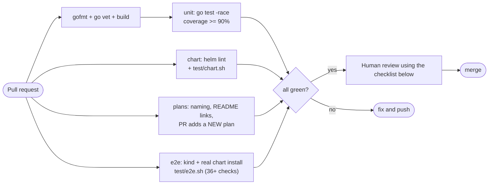

# 0002 – PR review and test gates

- **Status:** done
- **Date:** 2026-10-16
- **PR:** test framework + plans
- **Related plans:** [0001 How we got here](0001-how-we-got-here.md) · [0003 Test coverage map](0003-test-coverage-map.md)

## Why

The first e2e run found two real bugs ([0001 §8](0001-how-we-got-here.md)) that unit tests and manual checks had missed. Reviews need a repeatable process that makes sure every change is tested at the *right layer*, and that coverage cannot silently erode. This plan defines the gates (automated), the checklist (human/AI reviewer) and the rules for what must be tested.

## The rules

1. **Every PR adds a plan** (`plans/NNNN-slug.md` from [`TEMPLATE.md`](TEMPLATE.md)), linked from `README.md`. Enforced by `test/plans.sh`.
2. **Unit coverage of `internal/...` must be ≥ 90%.** Enforced by `test/coverage.sh` (CI job `unit`). The current baseline is 99.0%; a PR may not lower it below 90% and should not lower it meaningfully.
3. **Bug fix ⇒ regression test first.** The PR must show the test failing without the fix (note it in the plan).
4. **Right layer for the change** (table below).
5. **No green CI, no merge.** All four CI jobs (`unit`, `chart`, `plans`, `e2e`) are required.

## Which layer must cover which change

| If the PR changes… | Required tests |
| --- | --- |
| Reconciler logic, defaults merge, env/volume/probe wiring | Unit test in `internal/agent` asserting the generated object |
| `Service` (create/list/delete), validation, secrets | Unit test incl. the **error path** (use `interceptor.Funcs` to inject API failures) |
| REST routes, status codes | `internal/server` test via `httptest` |
| MCP tools or protocol | `internal/server` test for success **and** malformed input (`isError` vs transport error) |
| UI (`ui.html`) | Manual check below (no JS test harness yet – see follow-ups) + `TestUI` still passes |
| Chart templates / values | Assertion in `test/chart.sh` for each new value or branch |
| CRD schema | Update CRD YAML, `types.go`, and the CRD-parity loop in `test/chart.sh` together |
| RBAC, PVC/storage, ownership/GC, rollouts, anything the fake client can't enforce | **Step in `test/e2e.sh`** – the fake client cannot catch these classes of bug |
| Seed script / init container | Currently manual against the real image (see gap in [0001 §9](0001-how-we-got-here.md)); document the run in the plan |
| Dockerfile / release workflow | Build the image locally (`make image`) and run e2e with it |

## Gates



## Reviewer checklist

Copy into the review. Every "no" needs either a fix or an explicit, recorded reason in the plan.

**Plan**
- [ ] New `plans/NNNN-*.md` exists, is linked from README, and explains *why* (not just what)
- [ ] Diagrams updated if architecture, flows or lifecycle changed
- [ ] Test table in the plan names real tests that exist
- [ ] Old plans not rewritten; reversals explained and linked

**Tests**
- [ ] CI green; coverage ≥ 90% (open the `coverage` artifact if in doubt)
- [ ] Each new branch/error path has a test (look at the diff, not just the percentage – 90% can hide an untested new function)
- [ ] Tests assert behaviour (outputs, created objects, status codes), not implementation details
- [ ] Bug fix has a regression test that fails without the fix
- [ ] Chart change ⇒ `test/chart.sh` assertion; K8s-facing change ⇒ `test/e2e.sh` step
- [ ] No test depends on timing without a `retry` bound; no sleeps longer than necessary

**Safety**
- [ ] Secrets never appear in the CR, status, logs or error messages (see `TestCreateStoresKeysInOwnedSecret`)
- [ ] New RBAC verbs/resources are the minimum needed; Role (not ClusterRole) in the default mode
- [ ] Changes to deletion/retention are called out (data loss risk)
- [ ] User-visible changes documented in README

## Manual verification (for UI changes and releases)

1. `make image`, load into a throwaway cluster, `helm install` with `agentDefaults.image=busybox:1.37`.
2. `kubectl port-forward svc/hermes-operator 8080:80`; open `http://localhost:8080`.
3. Create an agent with advanced options (resources, storage, API key line). Card shows `Pending` then updates.
4. Delete: first click arms, second deletes; `kubectl get sts,pvc,secret` shows nothing left.
5. `claude mcp add --transport http hermes http://localhost:8080/mcp` (or any MCP client): list tools, create and delete an agent.

## Running everything locally

```sh
make check          # build, cover (>=90%), chart-lint, chart-test, plans-check
make e2e IMG=hermes-operator:e2e   # needs KUBECONFIG pointing at a THROWAWAY cluster
BASE_REF=origin/main make plans-check   # what CI runs on PRs
```

## Follow-ups

- Automated test for the seed script (containerised shell test) – closes the one behavioural gap with no automation.
- Browser-level UI test (Playwright) if the UI grows beyond a single page.
- Mutation testing pass (e.g. `go-mutesting`) to confirm the 99% coverage is meaningful.
- Make the 90% gate a ratchet (fail on any drop vs `main`).
