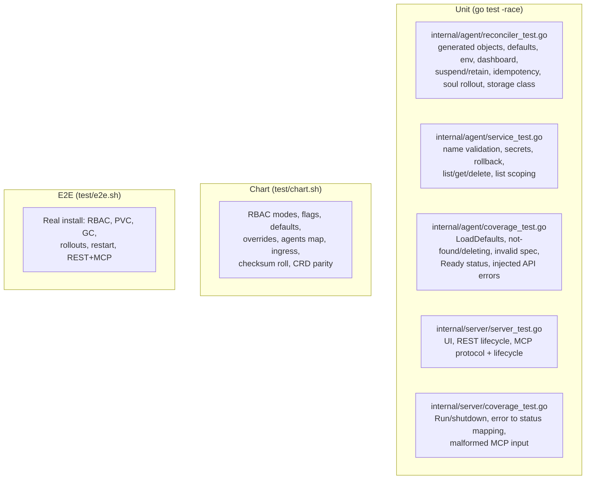

# 0003 – Test coverage map

- **Status:** done (living document – update when tests are added)
- **Date:** 2026-10-16
- **PR:** test framework + plans
- **Related plans:** [0001 How we got here](0001-how-we-got-here.md) · [0002 PR review and test gates](0002-pr-review-and-test-gates.md)

## Why

Coverage percentage says *how much* code runs under test, not *which promises* are verified. This map traces each promise the project makes (README, chart, owner decisions) to the tests that protect it, so a reviewer can see at a glance what a change might break and which tests to look at.

Current unit coverage of `internal/...`: **99.0%** (agent 98.6%, server 100%). Gate: **90%**.

## Test inventory

## Promise → tests

| Promise | Unit | Chart | E2E |
| --- | --- | --- | --- |
| Creates StatefulSet, Service, Secret, ConfigMap, PVC, owned by the CR | `TestCreatesOwnedResources` | – | "statefulset/service/secret/pvc created" |
| **No database**: operator restart loses nothing | `TestReconcileIsIdempotentAndPreservesKeys` | – | "api key survives operator restart" |
| Default CPU/memory **requests** set, no CPU limit | `TestDefaultResourcesAndOverride` | `override requests/limits`, `default: agent cpu/memory request` | "default cpu/memory request applied", "no cpu limit by default" |
| Per-agent resource **override** | `TestDefaultResourcesAndOverride` | – | "per-agent cpu request/limit override" |
| Chart-wide resource override reaches the operator | `TestLoadDefaults` | `override requests`, `override limits`, `defaults checksum rolls the operator` | install with chart defaults |
| Shared provider keys for every agent (optional secret) | `TestEnvAndEnvFrom` | `shared key secret` | – |
| Provider keys stored in a Secret, **never in the CR** | `TestCreateStoresKeysInOwnedSecret` | – | "API key not stored in the CR" |
| Failed create does not leak a Secret | `TestCreateDuplicateRollsBackSecret`, `TestServiceErrorPaths` | – | "duplicate create rejected (409)" |
| Agent API key generated once, stable | `TestReconcileIsIdempotentAndPreservesKeys` | – | "api key survives operator restart" |
| Dashboard opt-in with mandatory auth | `TestDashboard` | – | – |
| `spec.soul` change applied (overwrite + pod roll) | `TestSoulChangeRollsPod` | – | "soul change updates seed configmap", "…rolls the pod" |
| Edits inside the pod persist | – (shell behaviour) | – | **gap** – verified manually, see [0001 §9](0001-how-we-got-here.md) |
| `config.yaml` rendered from `model` / raw `spec.config` wins | `TestRenderConfig` | – | – |
| Empty `storageClassName` = cluster default | `TestEmptyStorageClassMeansClusterDefault` | – | "pvc created" (provisioner binds it) |
| Suspend keeps data, scales to 0 | `TestSuspendAndRetain` | – | "suspend scales to zero / keeps the pvc / phase Suspended" |
| Delete removes everything **including PVC**; `retainData` keeps it | `TestSuspendAndRetain`, `TestListGetDelete` | – | "statefulset/service/secrets garbage collected", "pvc deleted with the agent" |
| Status phase Pending/Ready/Suspended/Failed | `TestReadyWhenStatefulSetReady`, `TestReconcileInvalidSpecReportsFailed`, `TestCreatesOwnedResources` | – | "status.phase populated" |
| Reconcile errors are retried, not swallowed | `TestReconcileSurfacesAPIErrors` | – | – |
| Deleted/missing CR is ignored safely | `TestReconcileNotFoundAndDeleting` | – | – |
| Name validation (DNS label, ≤ 40) | `TestCreateValidatesName` | – | – |
| UI served; polls REST | `TestUI` | – | "UI served" |
| REST create/list/delete + status codes | `TestRESTLifecycle`, `TestRespondMapsErrorsToStatusCodes` | – | "REST create/delete", "listed in REST API" |
| **List works under a namespaced Role** (bug #1) | `TestListIsScopedToListNamespace`, `TestRESTListErrorIs500` | `default: Role (not ClusterRole)`, `explicit namespace` | "listed in REST API" |
| MCP: initialize, tools/list, tools/call, notifications | `TestMCPProtocol` | – | "mcp initialize" |
| MCP: create/get/list/delete, tool errors vs transport errors | `TestMCPAgentLifecycle`, `TestMCPMalformedRequests`, `TestMCPCreateWithAllOptions` | – | "mcp create_agent / delete_agent" |
| Server shuts down cleanly, reports listen errors | `TestRunServesAndShutsDownOnCancel`, `TestRunReturnsListenError` | – | operator pod ready |
| Least-privilege default; cluster-wide opt-in | – | `default: Role`, `all namespaces: ClusterRole` | install uses the real Role |
| Operator pod hardened (non-root, read-only FS) | – | `operator runs non-root, read-only fs` | pod Running |
| Agents declarable in Helm values | – | `agents: renders HermesAgent`, `spec passthrough` | "helm-declared agent gets a statefulset/service" |
| CRD matches the Go spec | `TestSpecOfRejectsNonObjectSpec` | `CRD spec.*` loop | CRD installed by chart |
| Ingress optional, off by default | – | `default: no ingress`, `ingress enabled/host` | – |

## Excluded from the coverage gate (and why)

| Code | Why excluded | Covered by |
| --- | --- | --- |
| `cmd/main.go` | Flag parsing and wiring; the testable parts (`LoadDefaults`) were extracted into `internal/agent` | Every e2e run starts the real binary |
| `Reconciler.SetupWithManager` | Needs a live manager/API server | e2e |
| `ui.html` JavaScript | No JS test harness | Manual checklist in [0002](0002-pr-review-and-test-gates.md); served-file check in `TestUI` |

## Known gaps

1. Seed script (`seedScript` in `reconciler.go`) file behaviour has no automated test.
2. No test for dashboard in e2e (unit only).
3. No upgrade test (installing version N, upgrading to N+1, CRD change).
4. UI JavaScript is untested.
5. Concurrency: simultaneous creates of the same name are covered only by the API server's own uniqueness (409), not stress-tested.

Closing any of these should be its own plan.
