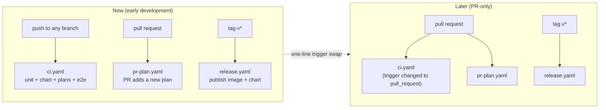

# 0004 – Run CI on every commit (for now)

- **Status:** done
- **Date:** 2026-10-16
- **PR:** CI trigger change
- **Related plans:** [0002 PR review and test gates](0002-pr-review-and-test-gates.md) (its gate diagram shows PR triggers; this plan changes the trigger, not the gates)

## Why

The project is in early development and work lands as direct commits. The first CI config only ran on `main` and on pull requests, so commits to other branches were unchecked. Checks should run on every commit now. The owner will later switch to PR-only checks, and does not want the same checks running twice once PRs are in use.

## What changes

| File | Change |
| --- | --- |
| `.github/workflows/ci.yaml` | Trigger is `push` on every branch (`"**"`) plus manual `workflow_dispatch`. No `pull_request` trigger, so nothing runs twice. A `concurrency` group cancels the older run when a branch gets a newer push. |
| `.github/workflows/pr-plan.yaml` (new) | Holds the one rule that only makes sense on a pull request: it must add a new plan (`BASE_REF=… test/plans.sh`). Tiny, so it is cheap on every PR. |
| `.github/workflows/release.yaml` | Unchanged: tags `v*` only. Branch pushes never trigger it (`branches` filter in `ci.yaml` excludes tags). |



## Switching to PR-only later

In `ci.yaml` replace

```yaml
on:
  push:
    branches: ["**"]
  workflow_dispatch:
```

with

```yaml
on:
  pull_request:
  push:
    branches: [main]
  workflow_dispatch:
```

and keep the `concurrency` block. Nothing else changes; `pr-plan.yaml` already only runs on pull requests. (Keep `push: main` if you want a post-merge check; drop it if the PR run is enough.)

## How it is tested

| Behaviour | Layer | Check |
| --- | --- | --- |
| Workflow files are valid YAML with the intended triggers and jobs | manual | Parsed with Ruby `YAML.load_file`: `ci` → push `**` + workflow_dispatch; `pr-plan` → pull_request; `release` → tags |
| The PR-plan rule still passes/fails correctly | local script | `test/plans.sh` positive and negative cases (orphan plan, bad name, no new plan, new plan) – run when 0002 was written and re-run here |
| Workflows actually trigger on a branch push | manual, after merge | Push a branch and confirm the `ci` run appears; confirm opening a PR starts only `pr-plan` |

- Coverage after this change: unchanged (99.0%; no Go code touched)
- Regression test added for any bug fixed: n/a

## Risks

- Every push to every branch runs the e2e job (about 2 minutes of GitHub minutes on a kind cluster). Acceptable while commit volume is low; the concurrency group cancels superseded runs.
- Until the first push on GitHub, the workflows have only been validated structurally, not executed.
- While there is no `pull_request` trigger on `ci.yaml`, a PR from a fork would not get the heavy checks. Only relevant once outside contributors arrive – that is the moment to apply the swap above.

## Follow-ups

- Make the `ci` jobs required status checks via branch protection once PR-only checks are enabled.
