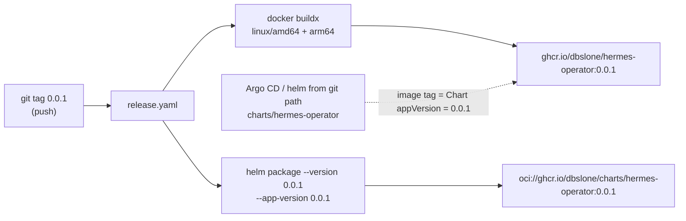

# 0005 – First release 0.0.1

- **Status:** done
- **Date:** 2026-10-16
- **PR:** release 0.0.1
- **Related plans:** [0001 How we got here](0001-how-we-got-here.md) · [0004 CI on every commit](0004-ci-on-every-commit.md)

## Why

The operator is about to be deployed from an Argo CD Application. That needs a published operator image: before this release `ghcr.io/dbslone/hermes-operator` did not exist, so any install would fail with `ImagePullBackOff`. The same work found that the e2e job in CI was failing.

## What changes

| Change | Detail |
| --- | --- |
| Version **0.0.1** | `Chart.yaml` `version` and `appVersion`, README dependency example, and the MCP `serverInfo` version. The chart's default image tag is `appVersion`, so installing the chart straight from git (as Argo CD does) pulls image `0.0.1`, which the release publishes. Leaving `0.1.0` would have pointed at an image that does not exist. |
| `release.yaml` trigger | Now fires on `v*` **and** bare `[0-9]*` tags. The version is the tag name minus a leading `v`, so `0.0.1` and `v0.0.1` both publish `ghcr.io/dbslone/hermes-operator:0.0.1` and chart `0.0.1`. |
| CI e2e fix | `helm/kind-action` names its cluster `chart-testing` by default, while the workflow ran `kind load docker-image` against the default name `kind` (`ERROR: no nodes found for cluster "kind"`). The action now sets `cluster_name: kind` and the load passes `--name kind`. |

## Releasing a new version

1. Update `version` and `appVersion` in `charts/hermes-operator/Chart.yaml` (and the MCP version in `internal/server/mcp.go`) to the new number. Both must match the tag, otherwise git-path installs reference a non-existent image.
2. Add a plan describing the release.
3. Wait for `ci` to be green on that commit.
4. `git tag X.Y.Z && git push origin X.Y.Z` (a `v` prefix also works).
5. Check the `release` run, then check the package.

## How it is tested

| Behaviour | Layer | Check |
| --- | --- | --- |
| Chart still lints/renders with the new version | chart | `make chart-lint chart-test` |
| Unit/server behaviour unaffected by the version string | unit | `make cover` (≥ 90%) |
| e2e job works on GitHub (kind cluster name) | CI | `ci` run on the release commit must be green before tagging |
| Tag publishes image and chart | manual | `release` run succeeds; `docker pull ghcr.io/dbslone/hermes-operator:0.0.1`; `helm pull oci://ghcr.io/dbslone/charts/hermes-operator --version 0.0.1` |

- Coverage after this change: unchanged (99.0%)
- Regression test added for any bug fixed: the CI cluster-name bug is caught by the e2e job itself.

## Risks

- **Package visibility.** New ghcr packages are often private. The cluster can only pull a private image with an `imagePullSecret`. Check the package settings after the first publish and make it public (the repo is public). Adding the `org.opencontainers.image.source` label would link the package to the repo; not done yet.
- A bad tag cannot be republished cleanly (`:0.0.1` is mutable in ghcr, but consumers may have cached it). Prefer a new patch version.
- The release workflow has no dependency on `ci`; that is why step 3 above is manual.

## Follow-ups

- Add the `org.opencontainers.image.source` label in the `Dockerfile` so the package inherits repo visibility.
- Make `release.yaml` wait for / require a green `ci` for the tagged commit.
