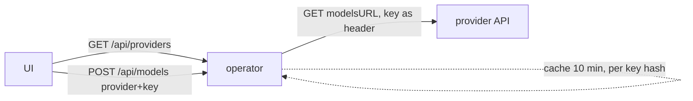

# 0008 – Dynamic provider and model dropdowns

- **Status:** in progress
- **Date:** 2026-10-16
- **PR:** release 0.0.3
- **Related plans:** [0006 Release 0.0.2](0006-release-0-0-2.md)

## Why

The UI's Provider and Model fields were free text, so users had to know exact ids. Hard-coding a model list in the operator would go stale with every provider release.

## What changes

| Change | Detail |
| --- | --- |
| `internal/models` | Provider list (embedded `providers.yaml`, merged with `--providers-file`) and a `Catalog` that GETs each provider's `modelsURL` and caches the sorted ids for 10 minutes. |
| REST | `GET /api/providers` (id, label, needsKey, keyEnv; no URL) and `POST /api/models {provider, apiKey}`. POST keeps the key out of URLs and access logs. |
| UI | Provider is a `<select>` plus "Other…"; Model is an input with a `<datalist>` (searchable, still free text). The key is read from the `KEY=value` env lines. Failures show a note and leave the field as plain text. |
| Chart | `providers: []` value, written to `providers.yaml` in the operator ConfigMap, `--providers-file` flag, included in the rollout checksum. |
| Version | 0.0.3 (Chart, MCP serverInfo, README). |

## Design and alternatives

- **Live fetch + cache** instead of a bundled list: no release when models change. A static list per release was rejected as stale by design.
- **Provider list is data** (built-in file + chart values): adding a provider is a values change. The ids are Hermes' `model.provider` values.
- **No URL from the browser.** A request-supplied base URL would make the unauthenticated endpoint an SSRF proxy into the cluster. Custom endpoints stay free text.
- **Key per lookup, cached by key hash**, never logged or stored; keyed results are not shared across keys. Considered key-free providers only; rejected as too limiting (Anthropic/OpenAI need keys).
- **Datalist for models**: OpenRouter lists ~460 models; a `<select>` would be unusable, and a datalist keeps free-text entry.

## How it is tested

| Behaviour | Layer | Test |
| --- | --- | --- |
| Built-ins load; override/add; malformed file errors | unit | `TestBuiltinProviders`, `TestLoadProvidersMerge` |
| Fetch, sort, auth headers per scheme | unit | `TestModelsFetchSortAndAuth` |
| Cache TTL and per-key isolation | unit | `TestModelsCache` |
| Unknown provider, missing key, HTTP/JSON/URL/context errors | unit | `TestModelsErrors`, `TestBadURL` |
| Endpoints, URL not exposed, nil catalog | unit | `TestProvidersAndModelsEndpoints` |
| `providers` value → ConfigMap, flag, none by default | chart | `test/chart.sh` "providers:" checks |
| Dropdowns in a browser | manual | open UI, pick OpenRouter, see ~460 models |

- Coverage after this change: 97.9% (must be ≥ 90%)
- Regression test added for any bug fixed: n/a

## Risks, rollout, rollback

- The UI sends a typed API key to the operator for the lookup. The UI has no authentication, so keep it cluster-internal (see README warning).
- Endpoints for DeepSeek, xAI, Fireworks, OpenAI and Anthropic were confirmed to exist (401 without a key) but not exercised with real keys. A wrong entry only degrades that provider to free text.
- Egress: the operator pod now needs outbound HTTPS to the configured providers.

## Follow-ups

- Show model metadata (context length) where the API provides it.
- Per-provider default models.
