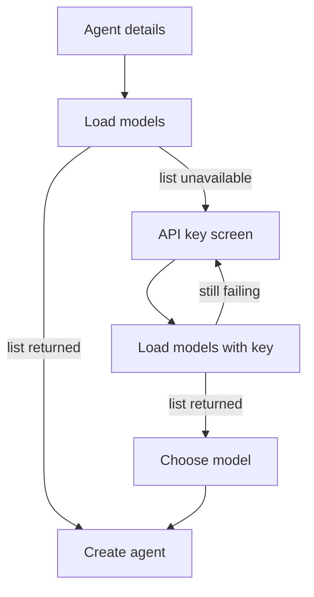

# 0011 – Model key wizard

- **Status:** done
- **Date:** 2026-10-19
- **PR:** unreleased (0.0.5)
- **Related plans:** [0008 Dynamic provider and model dropdowns](0008-dynamic-provider-and-model-dropdowns.md) · [0009 Model field is a real dropdown](0009-model-select-dropdown.md)

## Why

Choosing Anthropic, OpenAI, DeepSeek, xAI, or Fireworks could not list models until the user already knew the model id and had pasted a key under Advanced. The note then told them to type the id. The key screen should explain how to create or retrieve the key, and the next screen should ask which model to use.

## What changes

- Built-in providers carry `keyURL` and `keySteps`. `GET /api/providers` returns both. `modelsURL` stays off that response.
- New agent dialog: when `POST /api/models` fails for a known provider, the primary button is **Next**. That screen shows the provider's steps, a link, and a password field. **Next** loads models with that key. The following screen is a model dropdown (`(Hermes default)`, every model, `Other…`).
- The key is saved on the agent as `env[keyEnv]`. A key from this screen wins over the same variable in the advanced box.
- **Type a model id instead** still allows a typed id when the list cannot be loaded, including after a bad key.
- OpenRouter (and any provider whose list loads) keeps the model dropdown on the first screen. `(Hermes default)` and `Other…` provider stay free text.
- Chart `providers:` entries can set `keyURL` and `keySteps`; they are rendered into `providers.yaml`.
- Version 0.0.5 (Chart, MCP serverInfo, README).

## Design and alternatives

- **Steps live with the provider data**, not in the HTML, so a chart override can replace them and the UI test asserts whatever the API returns.
- **`keyURL` is a link the browser opens.** The operator does not fetch it, so it is not an SSRF target. The page only accepts `http:` and `https:` hrefs.
- **The wizard is only the failure path.** A loaded list stays on the first screen (plan 0009). Asking for a key before every provider was rejected because OpenRouter needs none.
- **Skip to a typed id** keeps the promise that a provider outage does not block creating an agent.

## How it is tested

| Behaviour | Layer | Test |
| --- | --- | --- |
| Built-in key URL and at least three steps; public list includes them | unit | `TestBuiltinProviders` |
| `keyURL` / `keySteps` on the wire; `modelsURL` omitted | unit | `TestProvidersAndModelsEndpoints` |
| OpenRouter stays a dropdown; no key screen | UI | `choosing a provider turns model into a select` |
| Failed list shows Next, not a text box | UI | `a provider whose model list cannot be fetched asks to continue` |
| Key screen shows returned steps and link | UI | `Next shows the provider key steps and link` |
| Valid key then model; key saved, wins over advanced env | UI | `a valid key advances to the model screen and is saved on the agent` |
| Rejected key stays put | UI | `a rejected key stays on the key screen` |
| Typed id skip; Back keeps the key; no steps falls back; unsafe link hidden | UI | `Type a model id instead…`, `Back from the model screen…`, `a provider with no key steps…` |
| `keyURL` rendered from chart values | chart | `providers: key help rendered` |

- Coverage after this change: 99.0% (must be ≥ 90%)
- Regression test added for any bug fixed: n/a

## Risks, rollout, rollback

- The UI still sends the API key to the operator for the lookup, and now also stores it in the agent Secret. The UI has no authentication; keep it cluster-internal.
- Key-page URLs and button names can drift. They are data in `providers.yaml`, so a wrong step is a values or image change, not a model-list outage.
- 0.0.5 is not published by this change. The cluster stays on `ghcr.io/dbslone/hermes-operator:0.0.4` until a release is cut and `gateway-helm` is bumped.
- Roll back by pinning the previous chart version.

## Follow-ups

- A type-to-filter box for very long lists (OpenRouter has hundreds of models).
- Publish 0.0.5 and bump the gateway subchart.
