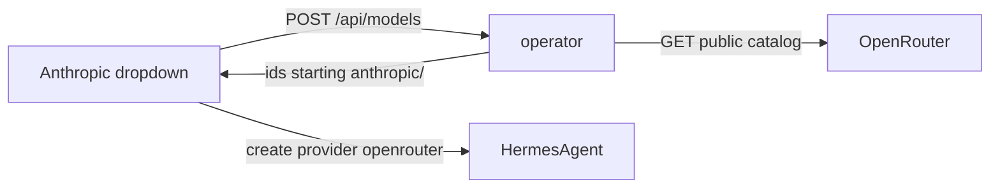

# 0013 – Anthropic models from OpenRouter

- **Status:** done
- **Date:** 2026-10-21
- **PR:** unreleased (0.0.7)
- **Related plans:** [0008](0008-dynamic-provider-and-model-dropdowns.md), [0012](0012-inline-provider-key.md)

## Why

The Anthropic dropdown asked for an `ANTHROPIC_API_KEY` before it could list models. That key is billed on the Claude Console, separate from a Claude subscription. The model list itself can come from OpenRouter's public catalog, which needs no key.

## What changes

- The built-in Anthropic entry reads `https://openrouter.ai/api/v1/models` with `auth: none` and keeps ids that start with `anthropic/`.
- `runtimeProvider: openrouter` is returned by `GET /api/providers`. The UI saves that provider on the agent, with the OpenRouter model id (for example `anthropic/claude-sonnet-4.5`).
- The model note tells the user to save `OPENROUTER_API_KEY` under Advanced. The API key line stays hidden, because listing does not need a key.
- `modelPrefix` stays server-side, with `modelsURL`. Chart `providers:` entries can set `modelPrefix` and `runtimeProvider`.
- OpenAI, DeepSeek, xAI, and Fireworks still list from their own APIs and still require their own keys.
- REST and MCP do not rewrite a posted `provider: anthropic`. Only the Anthropic dropdown uses the OpenRouter path.
- Version 0.0.7 (Chart, MCP serverInfo, README).

## Design and alternatives

OpenRouter still charges for Claude requests. This avoids a second Anthropic Console key. A hardcoded Claude id list would go stale. Calling `api.anthropic.com` needs the key this change is removing. Stripping the `anthropic/` prefix and still saving provider `anthropic` would send OpenRouter ids to the Anthropic API.

## How it is tested

| Behaviour | Layer | Test |
| --- | --- | --- |
| Built-in Anthropic lists from OpenRouter, prefix `anthropic/`, runtime provider `openrouter`, no key | unit | `TestBuiltinProviders` |
| Prefix drops other ids; public JSON omits `modelPrefix` and `modelsURL` | unit | `TestModelPrefix`, `TestBuiltinProviders` |
| Dropdown loads with no key and submits provider `openrouter` | ui | `Anthropic listed from OpenRouter submits the OpenRouter provider` |
| Chart renders `modelPrefix` and `runtimeProvider` | chart | `providers: model prefix rendered`, `providers: runtime provider rendered` |

- Coverage after this change: 99.0%
- Regression test added for any bug fixed: n/a

## Risks, rollout, rollback

OpenRouter bills Claude usage on the OpenRouter account. An agent created from the Anthropic dropdown does not call the Anthropic API and does not use `ANTHROPIC_API_KEY`. 0.0.7 is not published by this change. The cluster stays on the operator image it already runs until a release is cut and `gateway-helm` is bumped.

## Follow-ups

- Publish 0.0.7 and bump the gateway subchart.
