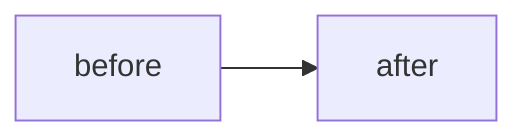

# NNNN – Title

- **Status:** proposed | in progress | done | superseded by NNNN
- **Date:** YYYY-MM-DD
- **PR:** #
- **Related plans:** [0001](0001-how-we-got-here.md)

## Why
What problem does this solve? What happens if we do nothing?

## What changes
Bullet the behaviour, API (CRD / REST / MCP / chart values) and file changes.

## Design and alternatives
The choice made and the options rejected, with reasons. Add or update a diagram if the architecture, data flow or lifecycle changed.

## How it is tested
| Behaviour | Layer (unit / chart / e2e / manual) | Test name or script step |
| --- | --- | --- |
|  |  |  |

- Coverage after this change: __%  (must be ≥ 90%)
- Regression test added for any bug fixed: yes / n/a

## Risks, rollout, rollback
Upgrade notes (CRD changes are not applied by `helm upgrade`), security impact, what to watch.

## Follow-ups
Known gaps deliberately left out.
